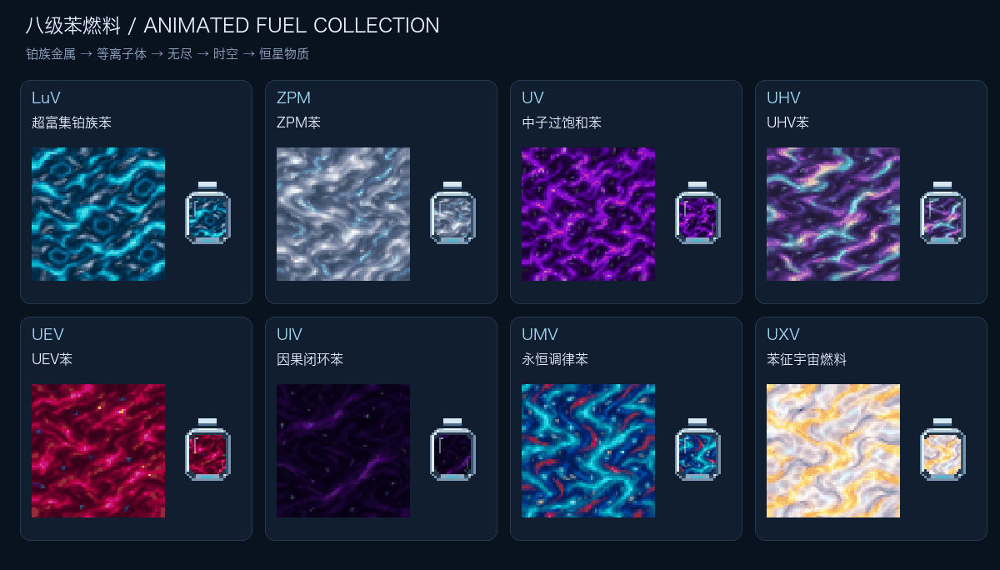
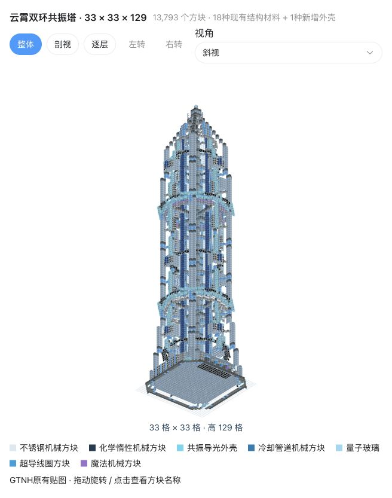

> Developed by **GPT-6 (Codex)** from arturia-Xayah's design.

# Benzene Fuels

**Eight fuel tiers · Sky-reaching resonance generator · Technology and magic boosts**

[简体中文](README.md) · **English** · [Releases](https://github.com/arturia-Xayah/gtnh-benzene-fuels/releases)

Minecraft **1.7.10** · GTNH **2.9.0**

Upgrade Nitrobenzene through LuV–UXV, build a tall Resonance Fuel Generator, and combine heating coils with technology and magic materials. Thirteen voltage stars cover LV–UXV.

## Contents

- [Installation and upgrading](#installation-and-upgrading)
- [Eight benzene fuels](#eight-benzene-fuels)
- [Resonance Fuel Generator](#resonance-fuel-generator)
- [Technology and magic boosts](#technology-and-magic-boosts)
- [Voltage stars](#voltage-stars)
- [Content availability and compatibility](#content-availability-and-compatibility)
- [Changelog](CHANGELOG.md)
- [Developer documentation](#developer-documentation)

## Installation and upgrading

1. Download `benzenefuels-0.4.6-alpha-GTNH-2.9.0.jar` into your instance's `mods` folder.
2. Multiplayer clients and servers need the same version; install on the client for single-player. Replace the previous Benzene Fuels JAR instead of keeping duplicates.
3. Use the dependencies included in **GTNH 2.9.0 stable**. No animation mod is needed.

This is separate from GTNH Modernization Upgrade / Structure Terminal. Version 0.4.6 retains existing fluid, item and controller IDs, recipes, heat values and generation settings.

0.4.6 adds hatch replacement candidates in the structure preview, fixes the delivery readout at batch transitions, and uses colored status text and compact numbers. Hover over controller statistics for exact parallel/input values and dynamo buffers; right-click a hatch position in the structure preview to see replacements.

## Eight benzene fuels

Each stage draws on its recipe ingredients: silver-blue platinum-group metal, tin plasma, dense neutronium, iridescent Infinity, spacetime stars and constrained stellar matter. All eight fluids and cells have **64×64, 64-frame native looping animations**. Cell shells stay still while their contents flow.

| Tier | Fuel | Heat EU/mB |
|---|---|---:|
| LuV | Hyper-Enriched Platinum-Group Benzene | 13.94K |
| ZPM | ZPM Benzene | 136.2K |
| UV | Neutron-Supersaturated Benzene | 1.491M |
| UHV | UHV Benzene | 18.29M |
| UEV | UEV Benzene | 251.5M |
| UIV | Causal-Loop Benzene | 3.876G |
| UMV | Eternally Attuned Benzene | 66.95G |
| UXV | Eigenbenzene Cosmic Fuel | 1.296T |

Use NEI **R / U** for recipes and uses. LuV–UEV enter the native gas-fuel map; machine buffers, rotors and output limits still apply. The Resonance Fuel Generator reads the full heat values of UIV–UXV.

This guide uses **1 B = 1000 mB**. Heat is measured per original mB unit, with the same conversion used for the generator's B display.

[All upgrade recipes and quantities](docs/features/FUELS.md#english) · [Artwork and generation prompts](design/fuel-textures/README.md)

## Resonance Fuel Generator

A **33×33×129** tower with **1648 same-tier heating coils** around its central column. Default parallelism is 1: Cupronickel permits 1, Kanthal permits 4, and higher coils raise the ceiling.

1. Follow the [material list](design/generator-materials.md). Install **1–3 fluid inputs, exactly one maintenance hatch and 0–16 dynamos** in their designated front/rear positions.
2. Supply fuel plus technology and magic base fluids. A batch lasts **5 seconds**; each parallel consumes **1 B fuel** and **1 mB of each base**.
3. Open the side settings panel to set the parallel cap. Available whole buckets, your setting and the coil limit determine the actual batch.
4. Output through dynamos, or use the dedicated **wireless** button to credit the owner's native GT wireless network.

Press **R or U on the controller**, or **U on a fuel/base fluid or cell**, to open generation recipes. All Mk1–Mk5 base combinations show batch energy and average output with both exponents at 1 (no core upgrades).

Generation is spread evenly across 100 ticks. Full buffers or insufficient dynamo throughput lose excess energy while the batch continues. The GUI shows fuel input, efficiency, generation, delivery and delivery percentage, plus both material routes.

[Structure, coil formula, input selection and operating rules](docs/features/GENERATOR.md#english)

## Technology and magic boosts

Both routes have Mk1–Mk5 base fluids and exponent cores. **Bases are consumed; cores are permanent upgrades.** Insert cores into the controller's bottom-right slot in Mk1→Mk5 order, one per tier.

| Mk | Technology base | Technology exponent | Magic base | Magic exponent |
|---|---:|---:|---:|---:|
| 1 | 1.01 | 2 | 1.01 | 2 |
| 2 | 1.02 | 4 | 1.05 | 4 |
| 3 | 1.05 | 8 | 1.10 | 6 |
| 4 | 1.07 | 16 | 1.20 | 8 |
| 5 | 1.10 | 32 | 1.30 | 10 |

Multiplier: `technology_base^technology_exponent × magic_base^magic_exponent`. Each unupgraded exponent is 1. Duplicate, skipped-tier and lower-tier cores are not consumed. Upgrades during a batch apply next batch and survive controller pickup.

[Component artwork and animated previews](design/component-textures/README.md)

## Voltage stars

Thirteen tiers from LV to UXV combine motors, pistons, pumps, conveyors, robot arms, emitters, sensors and field generators. Higher recipes also consume previous-tier stars.

LV–IV use the assembler; LuV onward use the assembly line. Stars are craftable, but their conversion to exponent cores has not been assigned.

[Full quantities and progression](docs/features/PROGRESSION.md#english)

## Content availability and compatibility

- Fuel upgrades, voltage stars and cell filling/emptying recipes are implemented.
- Survival recipes for the generator controller, light casing, bases and exponent cores remain undecided; obtain them through creative/NEI. Catalysts, stars, exponent cores and base cells now have dedicated sprites.
- Target: **GTNH 2.9.0 / GT5 5.09.54.265**, using the pack's GregTech, Good Generator, GT++, AE2, StructureLib, GTNHLib, ModularUI and UniMixins.
- Settings live in `config/benzenefuels.cfg`. Default GT controller ID: **32240**. Both sides need the same ID; do not change it after placing controllers.

## Developer documentation

[Build, source map, validation and artwork regeneration](docs/development/README.md)

[License](LICENSE) · [Upstream and artwork credits](THIRD_PARTY_NOTICES.md)
