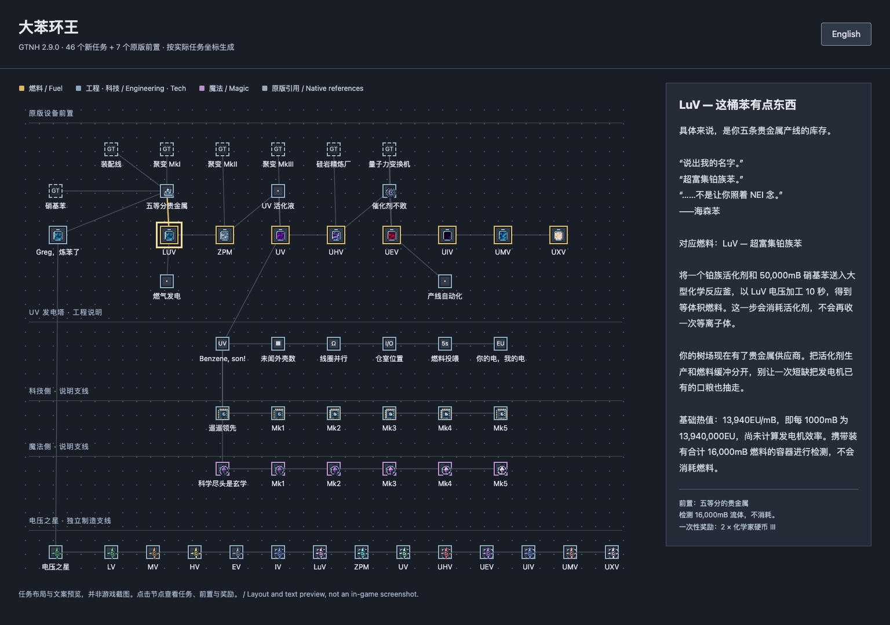
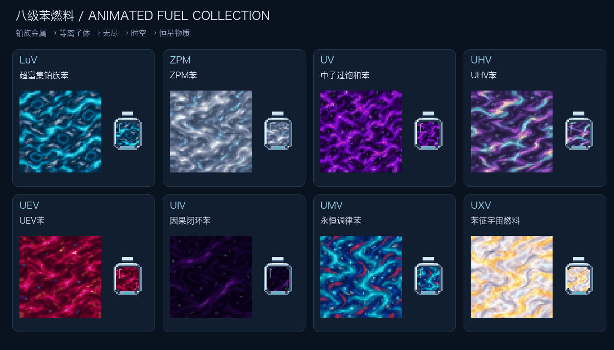
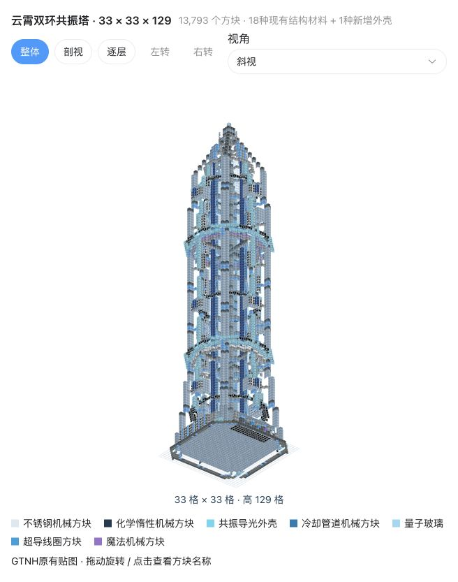

> 本 Mod 由 **GPT-6（Codex）** 按 arturia-Xayah 的设计开发。

# 苯燃料拓展 · Benzene Fuels

**八级苯燃料 · 云霄共振发电塔 · 科技与魔法增益**

**简体中文** · [English](README.en.md) · [版本下载](https://github.com/arturia-Xayah/gtnh-benzene-fuels/releases)

Minecraft **1.7.10** · GTNH **2.9.0**

从硝基苯出发，逐级生产 LuV～UXV 燃料；建设高耸的共振发电塔，通过线圈、科技和魔法材料提高发电能力。另有 LV～UXV 十三个等级的电压之星。

## 目录

- [安装与升级](#安装与升级)
- [任务书：大苯环王](#任务书大苯环王)
- [八级苯燃料](#八级苯燃料)
- [共振燃料发电塔](#共振燃料发电塔)
- [科技与魔法增益](#科技与魔法增益)
- [电压之星](#电压之星)
- [内容获取与兼容性](#内容获取与兼容性)
- [更新日志](CHANGELOG.md)
- [开发者文档](#开发者文档)

## 安装与升级

1. 下载 `benzenefuels-0.5.1-alpha-GTNH-2.9.0.jar`，放入实例的 `mods` 目录。
2. 联机时客户端和服务端安装相同版本；单人游戏安装在客户端。替换旧版 Benzene Fuels JAR，不要重复安装。
3. 使用 GTNH **2.9.0 正式版**自带的依赖，无需额外安装动画模组。

本模组独立于 GTNH现代化升级／结构终端。升级至 0.5.1 保留原有燃料、物品和主机注册 ID；原有燃料热值、配方及发电设置不变。

0.5.1 将章节命名为「大苯环王」，加入关键任务梗名与三位虚构角色的点评，中英双语随游戏语言切换。更新 JAR 并重启后自动加入，无需手动导入或重置任务。

## 任务书：大苯环王

**46 个新任务，7 个原版任务引用**。章节位于原版生物燃料章节之后，沿用原版实物／流体检测、勾选说明与职业硬币奖励。

- **燃料主线**：从硝基苯、装配线与聚变起步，经过活化剂、精炼厂和 QFT，逐级推进至 UXV。每级检测 16,000mB 燃料，不收走物品或流体；里程碑发少量化学家硬币。
- **发电塔工程**：UV 燃料后展开，介绍结构备料、线圈、仓室、5 秒供料和有线／无线输出；材料清单为可选提示。
- **科技／魔法**：分别讲解 Mk1～Mk5 底数和指数。按现有进度仅作说明，不提交、不发放暂无配方的材料，也不挡住燃料主线。
- **电压之星**：独立的 LV～UXV 制造支线，检测成品后奖励少量技术员硬币，不收走星星。

已完成的原版任务无需重做。新增任务使用独立固定编号，保留旧存档进度和领奖记录；原版默认任务书重载后仍保留本章。

[任务设计、安装与管理](docs/features/QUESTS.md) · [可点击的中英布局预览](questbook/preview.html)

## 八级苯燃料

每一级融合对应配方原料的视觉特征：铂族银蓝、锡等离子体、中子素紫流、无尽虹彩、时空星点，直到受约束的恒星物质。八种流体与燃料单元均使用 **64×64、64 帧循环动画**；单元外壳固定，内部液体流动。

| 阶段 | 燃料 | 热值 EU/mB |
|---|---|---:|
| LuV | 超富集铂族苯 | 13.94K |
| ZPM | ZPM苯 | 136.2K |
| UV | 中子过饱和苯 | 1.491M |
| UHV | UHV苯 | 18.29M |
| UEV | UEV苯 | 251.5M |
| UIV | 因果闭环苯 | 3.876G |
| UMV | 永恒调律苯 | 66.95G |
| UXV | 苯征宇宙燃料 | 1.296T |

通过 NEI 的 **R / U** 查看制作与用途。LuV～UEV 接入原生燃气燃料表，实际使用仍受设备容量、转子与输出能力限制；UIV～UXV 由共振发电塔读取完整热值。

本文使用 **1 B = 1000 mB**。热值按原始流体单位 mB 计算；发电塔界面的 B 与配方数量采用同一换算。

[全部升级配方与用量](docs/features/FUELS.md) · [动画原画与提示词](design/fuel-textures/README.md)

## 共振燃料发电塔

**33×33×129** 的高塔，中央立柱由 **1648 个同级加热线圈**包覆。默认 1 并行，白铜线圈支持 1 并行、坎塔尔支持 4 并行，更高线圈继续提高上限。

1. 按[结构材料清单](design/generator-materials.md)搭建，安装 **1～3 个输入仓、1 个维护仓、0～16 个动力仓**。输入仓在主机同面的允许区域，动力仓在背面指定两排。
2. 同时供应燃料、科技底数流体和魔法底数流体。每批持续 **5 秒**，每并行消耗 **1 B 燃料**，两侧底数各消耗 **1 mB**。
3. 侧边设置窗口调整并行上限；实际消耗受现有燃料量、设定值与线圈上限共同限制。
4. 使用动力仓输出，或点击独立按钮切换**无线模式**，写入主机所有者的 GT 无线网络。

对主机按 **R 或 U** 可打开发电配方页；对燃料／底数流体或其单元按 **U** 可查询对应发电用途。页面列出两侧 Mk1～Mk5 的组合，并按未升级指数核心（两侧指数均为 1）显示每批能量和平均功率。

发电在整批 100 tick 内均匀输出。动力仓满或输出能力不足时，多余能量直接损失，机器继续完成本批。GUI 显示当前输入、燃料效率、发电、实际发送及发送率，以及两侧材料等级。

[搭建位置、线圈并行、供料顺序与运行规则](docs/features/GENERATOR.md)

## 科技与魔法增益

两侧各有 Mk1～Mk5 底数流体与指数核心。**底数流体持续消耗，指数核心永久升级**：放入主机右下角物品格，按 Mk1→Mk5 顺序逐级吸收，每级一个。

| Mk | 科技底数 | 科技指数 | 魔法底数 | 魔法指数 |
|---|---:|---:|---:|---:|
| 1 | 1.01 | 2 | 1.01 | 2 |
| 2 | 1.02 | 4 | 1.05 | 4 |
| 3 | 1.05 | 8 | 1.10 | 6 |
| 4 | 1.07 | 16 | 1.20 | 8 |
| 5 | 1.10 | 32 | 1.30 | 10 |

燃料倍率为 `科技底数^科技指数 × 魔法底数^魔法指数`。未安装核心时，两侧指数均为 1。重复、跳级或降级核心不会消耗；运行中升级从下一批生效，拆下主机仍保留升级。

[部件材质总览与动态预览](design/component-textures/README.md)

## 电压之星

LV～UXV 共十三种。每级配方组合马达、活塞、泵、输送带、机械臂、发射器、传感器和力场发生器；高等级还需要上级之星。

LV～IV 使用组装机，LuV 起使用装配线。星星目前可合成，尚未指定与指数核心的兑换关系。

[完整配方数量与等级表](docs/features/PROGRESSION.md)

## 内容获取与兼容性

- 燃料升级、电压之星、燃料单元装填／倒出配方已实装。
- 发电塔主机、导光外壳、底数材料与指数核心的生存合成配方待定，可从创造物品栏／NEI 取得。催化剂、之星、指数核心和底数单元均已配备独立材质。
- 目标为 **GTNH 2.9.0 / GT5 5.09.54.265**，使用整合包中的 GregTech、Good Generator、GT++、AE2、StructureLib、GTNHLib、ModularUI 和 UniMixins。
- 配置位于 `config/benzenefuels.cfg`。主机默认 GT ID 为 **32240**；客户端和服务端须一致，已有主机放置后不要修改此 ID。

## 开发者文档

[构建、源码入口、测试报告与美术再生成](docs/development/README.md)

[许可证](LICENSE) · [上游与素材鸣谢](THIRD_PARTY_NOTICES.md)
